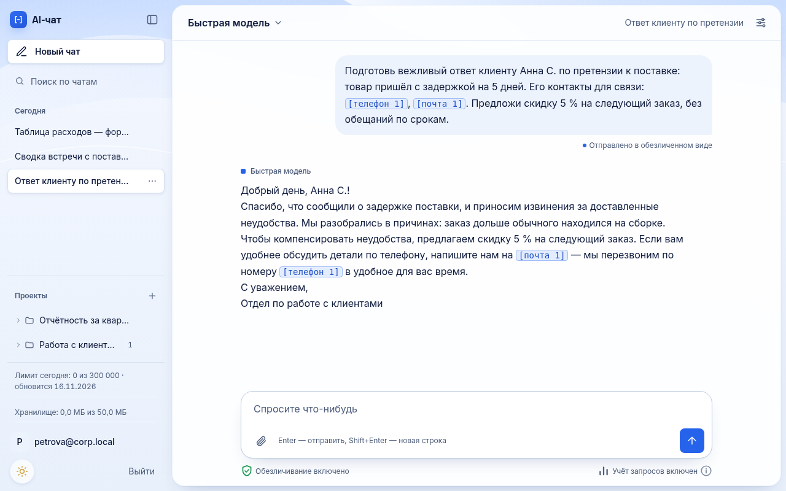
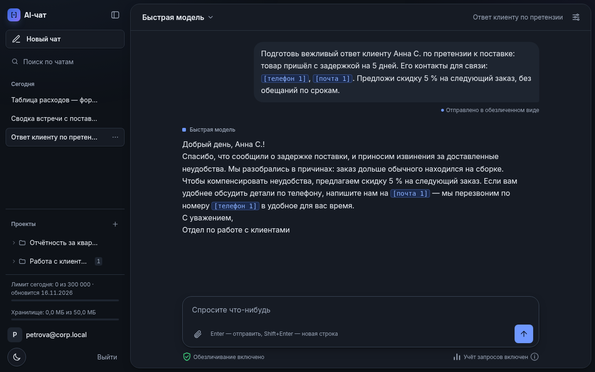
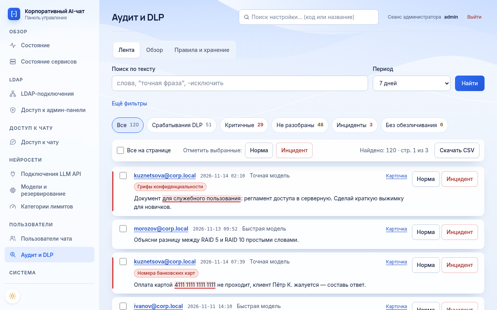
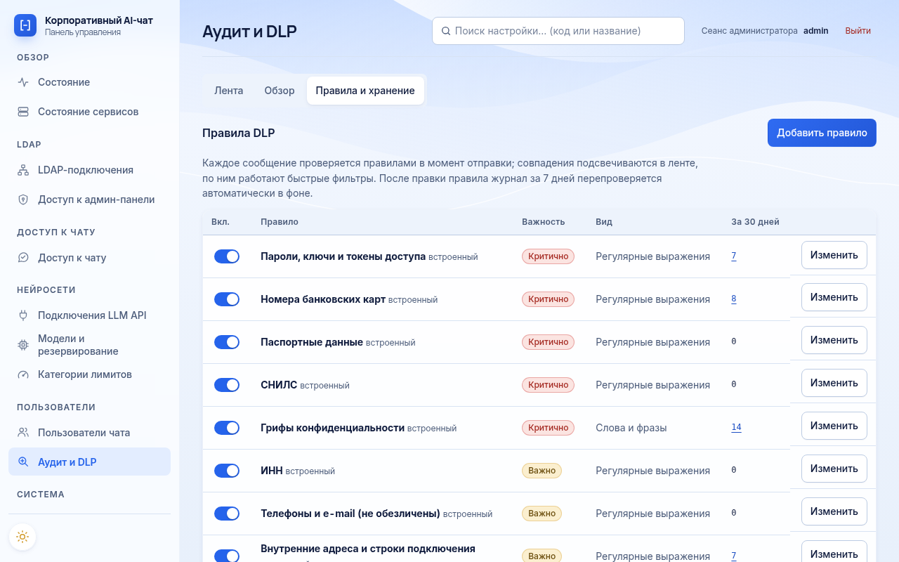
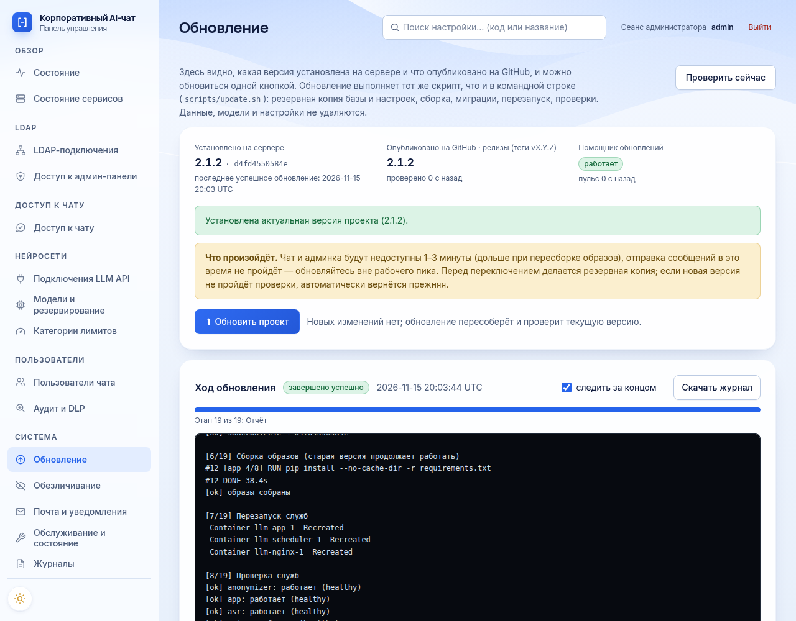

# LLM-провайдер — корпоративный AI-чат

[](https://github.com/calleograph/llm-provider/actions/workflows/ci.yml)
[](https://github.com/calleograph/llm-provider/releases/latest)

Корпоративный чат с внешними нейросетями, который вы устанавливаете на свой сервер. Сотрудники входят доменной учётной
записью, а всё, что уходит наружу, предварительно **обезличивается на вашем сервере**: ФИО, телефоны, адреса, пароли,
токены заменяются метками. Администратор управляет доступом, моделями и лимитами в веб-админке и видит, что и кем
отправлялось во внешние нейросети.

## Возможности

**Для сотрудников**
- Вход логином и паролем Windows (LDAPS, группы Active Directory), пароль нигде не сохраняется.
- Несколько нейросетей и моделей в одном окне; при сбое запрос автоматически уходит в резервную модель.
- Файлы (PDF, DOCX, ODT, XLSX, TXT, CSV, MD, изображения с распознаванием текста): исходный файл наружу не передаётся,
  извлечённый текст обезличивается.
- Проекты: общие инструкции, материалы и память для группы чатов.
- Голосовой ввод на русском языке: распознавание работает на вашем сервере.
- Светлая и тёмная тема, подсказки по работе с чатом.

**Для администраторов**
- Доступ по группам и отдельным пользователям домена; набор нейросетей и моделей для каждой группы.
- Лимиты токенов в день, неделю или месяц и **на один чат** (длинный разговор дорожает с каждым сообщением, поэтому по достижении лимита чат предлагает начать новый), квоты хранения, блокировка и очистка истории пользователей.
- **Аудит и DLP:** лента всего, что ушло во внешние нейросети, с полнотекстовым поиском, правилами выявления
  конфиденциальных данных (карты, паспорт, СНИЛС, ИНН, пароли и ключи, грифы, свои правила), отметками
  «Норма» и «Инцидент», выгрузкой в CSV. Каждый просмотр администратором фиксируется в журнале.
- **Обновление в один клик** прямо из админки: проверка новой версии на GitHub, ход установки в окне-терминале,
  резервная копия и автоматический откат при сбое.
- Почтовые уведомления, журналы, резервные копии, диагностика всех компонентов на одной странице.

## Как это выглядит

Скриншоты сделаны на тестовых данных.

**Чат.** Персональные данные заменяются метками до отправки; светлая и тёмная темы переключаются одной кнопкой.

<p>
  
  
</p>

**Аудит и DLP.** Лента отправленного с поиском, подсветкой совпадений и отметками «Норма» и «Инцидент»; правила выявления
конфиденциальных данных.

<p>
  
  
</p>

**Обновление.** Версии, кнопка «Обновить проект» и ход установки в окне-терминале.



## Как защищены данные

- Текст обезличивается встроенным сервисом на вашем сервере (без доступа в интернет) и проверяется повторно.
  Если обезличивание не работает или есть сомнение — сообщение не отправляется.
- История, инструкции и материалы проектов хранятся только в обезличенном виде.
- Сертификаты проверяются всегда, без исключений; доступ к нейросетям определяется на сервере при каждом запросе.
- Подробно — [docs/SECURITY.md](docs/SECURITY.md) и [docs/ANONYMIZATION.md](docs/ANONYMIZATION.md).

## Требования

| | |
|---|---|
| Система | Linux x86_64 или aarch64 (Ubuntu 22.04+, Debian 12+) |
| Программы | Docker Engine 24+ с Compose v2 (на выделенном сервере установщик ставит их сам) |
| Память | 3 ГБ с голосовым вводом, 2 ГБ без него |
| Диск | 12 ГБ свободного места |
| Сеть | TCP/636 от сервера до контроллеров домена; HTTPS до API нейросетей; доступ пользователей к сайту |

## Установка

```bash
git clone https://github.com/calleograph/llm-provider.git /opt/llm-provider
cd /opt/llm-provider
./install.sh --dry-run     # показать, что будет сделано
sudo ./install.sh          # установка
```

Установщик сам подготовит всё необходимое: образы, модели обезличивания и распознавания речи, служебного помощника
обновлений. В конце он выведет **логин и пароль администратора — один раз, сохраните их**.

Два режима установки:

- **Выделенный сервер** (`--profile standalone`): при необходимости установит Docker и опубликует сайт на порту.
  Пример: `sudo ./install.sh --profile standalone --bind 0.0.0.0 --port 8084 --publish port` — сайт откроется
  по адресу `http://IP-сервера:8084`.
- **Общий сервер** (`--profile shared-host`): ничего на хосте не ставит и не меняет, порт открывается только на
  `127.0.0.1`; чужие контейнеры, сайты и правила файрвола не затрагиваются.

Полезные параметры: `--no-voice` — без голосового ввода, `--port`, `--bind`, `--publish port|nginx`. Объём
процессов и память установщик подбирает по ОЗУ сервера. Подробности — в [docs/OPERATIONS.md](docs/OPERATIONS.md).

### Первый вход

Админка находится по адресу `/admin/` (например `http://IP:8084/admin/`), логин `admin`. Чат — по корню сайта,
в него входят доменной учётной записью. Забыли пароль администратора — выполните на сервере:

```bash
./scripts/ctl.sh admin-reset      # новый пароль, печатается один раз
```

### HTTP и HTTPS

Сайт сразу работает по `http://IP:порт`, без принудительных перенаправлений: так проще начать. Для рабочей эксплуатации
поставьте перед ним любой reverse proxy с HTTPS и укажите его адрес в админке: **Система → Настройки → Доверенные
reverse proxy**. Голосовой ввод браузеры разрешают только по HTTPS.

## Первичная настройка

Все шаги выполняются в админке.

1. **Сертификаты** (LDAP-подключения → Сертификаты). Загрузите корневой и промежуточные сертификаты, которыми подписаны
   LDAPS-сертификаты ваших контроллеров домена. Приватные ключи не нужны.
2. **Подключение к домену** (LDAP-подключения). Укажите контроллер, порт 636, Base DN и домен; при необходимости —
   служебную учётную запись только для чтения. Нажмите «Проверить»: проверяются DNS, порт, цепочка сертификатов и вход.
3. **Доступ к чату.** Добавьте разрешённые группы или пользователей и отметьте нейросети для каждой. Пользователь из
   нескольких групп получает объединение прав. Базовая модель доступна каждому, кого допустили в чат.
4. **Нейросети и модели** (Подключения LLM API, Модели и резервирование). Добавьте провайдера (OpenAI, Anthropic или
   совместимый), адрес и ключ, затем модели и цепочки резервирования. «Проверить подключение» отправляет тестовый
   запрос без пользовательских данных.
5. **Лимиты** (Категории лимитов). По умолчанию новым пользователям назначается 300 000 токенов в день. Расход одного чата ограничен отдельно (по умолчанию 200 000 токенов; Подключения LLM API → Общие параметры → «Лимит токенов на один чат», 0 — без ограничения).
6. **Правила DLP** (Аудит и DLP → Правила и хранение). Встроенные шаблоны уже включены; добавьте свои слова и
   выражения, укажите срок хранения журнала.
7. **Почта** (Почта и уведомления). SMTP с пошаговой проверкой и тестовым письмом.

Страницы **Состояние** и **Состояние сервисов** должны стать зелёными. Затем выполните проверку:

```bash
./scripts/ctl.sh verify && ./scripts/ctl.sh smoke
```

И убедитесь вручную: тестовый пользователь из разрешённой группы входит, а посторонний — нет; в истории чата вместо
вымышленных ФИО и телефона стоят метки; при остановленном обезличивании отправка блокируется.

## Обновление

**Из админки:** Система → Обновление → «Проверить сейчас» → «Обновить проект». Ход установки виден в окне-терминале.
Перед переключением делается резервная копия; если новая версия не проходит проверки, автоматически возвращается
прежняя. Данные, ключи и настройки сохраняются.

**С сервера:**

```bash
cd /opt/llm-provider
sudo scripts/check-updates.sh     # есть ли новая версия
sudo scripts/update.sh            # обновить
sudo scripts/rollback.sh          # вернуться на предыдущую версию
```

Список изменений каждой версии — в [CHANGELOG.md](CHANGELOG.md) и на странице [Releases](https://github.com/calleograph/llm-provider/releases).
Обновление с версии 1.x описано в [docs/OPERATIONS.md](docs/OPERATIONS.md).

## Если что-то не работает

| Симптом | Что проверить |
|---|---|
| «Сервер Active Directory временно недоступен» | Разрешается ли имя контроллера на сервере (`getent hosts имя`), открыт ли TCP/636, загружена ли полная цепочка сертификатов, совпадает ли имя в сертификате, правильно ли время. Проверку всех шагов делает кнопка «Проверить» в LDAP-подключениях. Не отключайте проверку сертификата. |
| Локальный администратор не входит | Логин `admin` вводится на странице **/admin/**, а не на странице входа в чат. После нескольких неудач включается пауза на несколько секунд. Новый пароль — `./scripts/ctl.sh admin-reset`. |
| Пользователь не может войти в чат | Состоит ли он в разрешённой группе или добавлен отдельно; доступен ли LDAPS («Состояние сервисов»); действителен ли пароль служебной учётной записи. |
| «Сервис обезличивания недоступен» | `./scripts/ctl.sh verify`, `./scripts/ctl.sh logs anonymizer`. Пока обезличивание не отвечает, отправка наружу заблокирована намеренно. |
| Ошибка TLS при обращении к нейросети | Если трафик идёт через корпоративный прокси, загрузите его корневой сертификат в «Сертификаты». |
| Не работает голосовой ввод | Нужен HTTPS и разрешение микрофона в браузере; на сервере должно быть 3 ГБ памяти и установка без `--no-voice`. Нет весов модели — `./scripts/ctl.sh models` (скачает их и покажет причину, если не получится), затем `./scripts/ctl.sh restart asr`. |
| Кнопка «Обновить проект» неактивна | Служебный помощник не отвечает: выполните `sudo scripts/updater.sh install`. Обновить можно и командой `sudo scripts/update.sh`. |
| Нужна диагностика | Админка → Журналы; архив с замаскированными секретами — `./scripts/ctl.sh diag`; логи — `./scripts/ctl.sh logs app`. |

## Документация

| Документ | О чём |
|---|---|
| [docs/OPERATIONS.md](docs/OPERATIONS.md) | установка, обслуживание, резервные копии, обновление и откат |
| [docs/SECURITY.md](docs/SECURITY.md) | защитные решения и модель угроз |
| [docs/ANONYMIZATION.md](docs/ANONYMIZATION.md) | как работает обезличивание и как проверяется его качество |
| [docs/PROJECTS.md](docs/PROJECTS.md) | проекты: инструкции, материалы, память, настройки |
| [CHANGELOG.md](CHANGELOG.md) | что нового в каждой версии |

## Для разработчиков

Приложение написано на Python (FastAPI, Jinja2, SQLite), сервисы обезличивания и распознавания речи — отдельные
контейнеры. Запуск тестов:

```bash
python3 -m venv .venv && .venv/bin/pip install -r requirements.txt -r requirements-dev.txt
.venv/bin/python -m pytest
python3 scripts/check_private_data.py     # в репозитории нет внутренних адресов и имён
```

Тесты сервисов находятся в `services/anonymizer` и `services/asr`. Автоматические тесты не заменяют проверку
с вашим контроллером домена и вашими провайдерами нейросетей.
